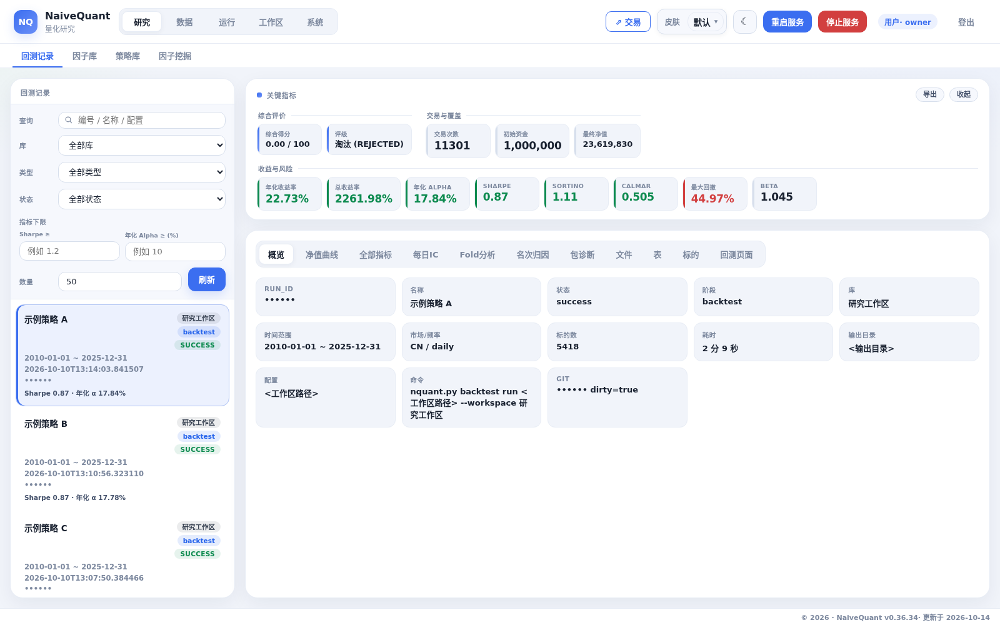
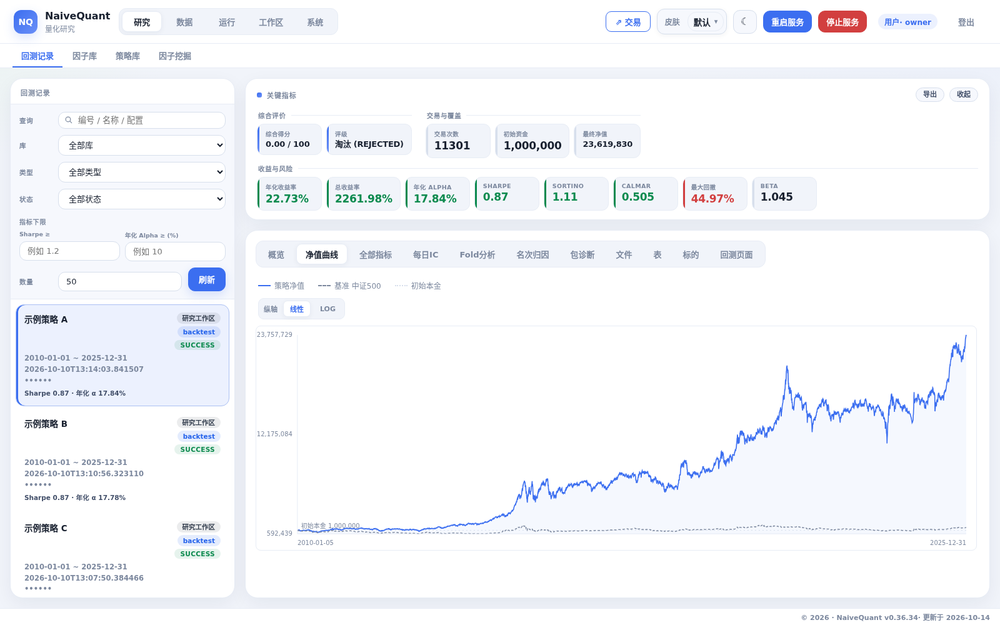
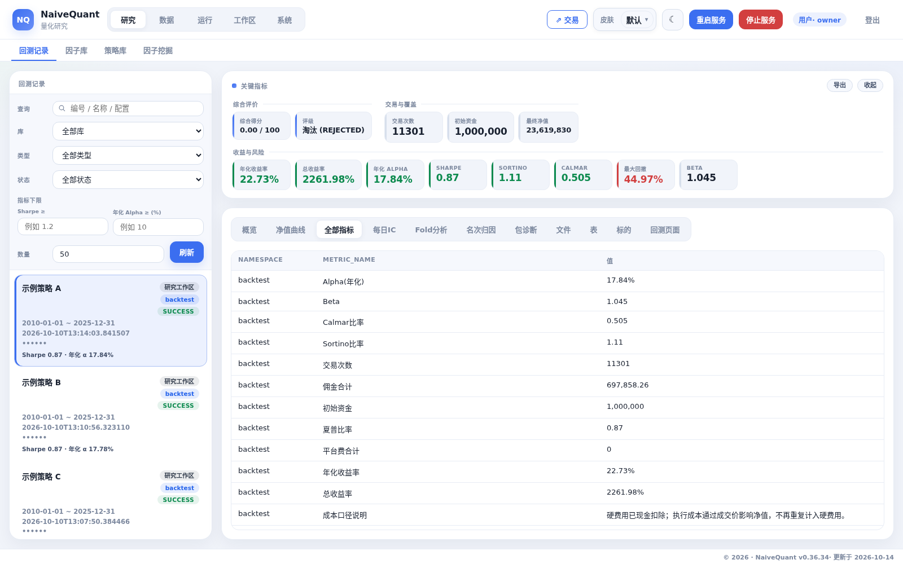
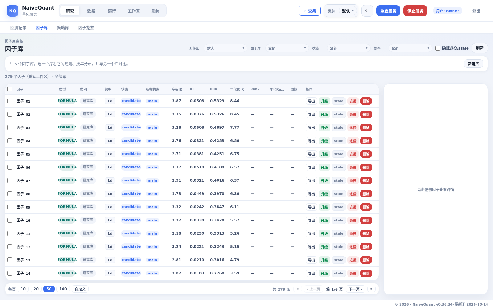
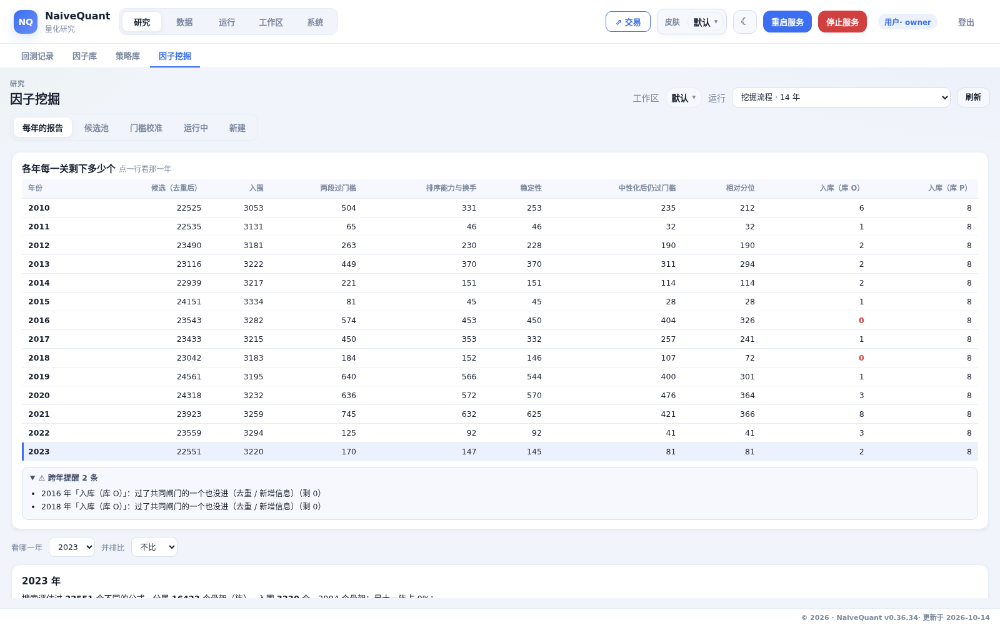
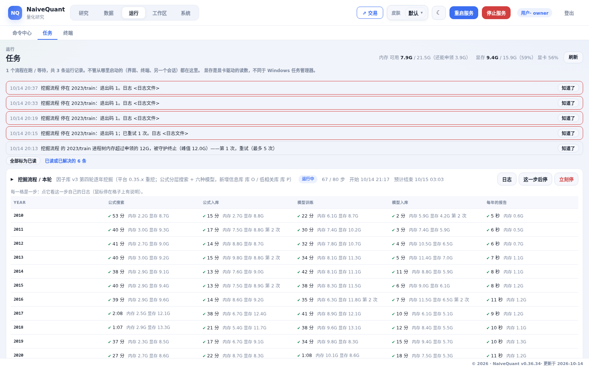
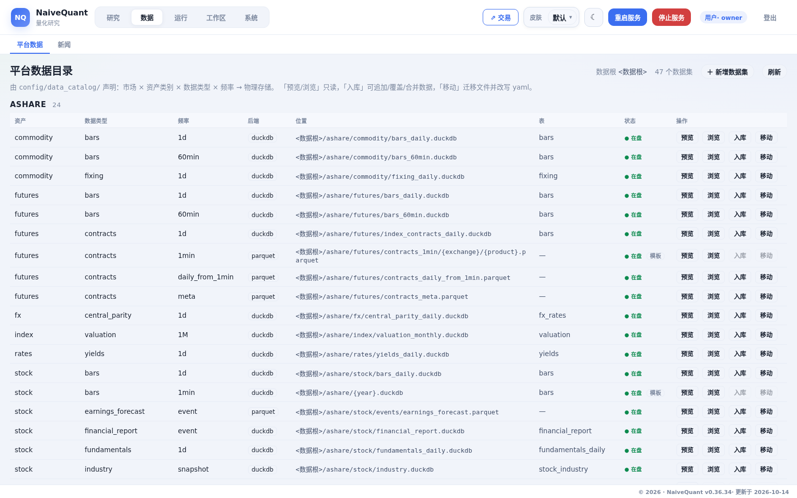
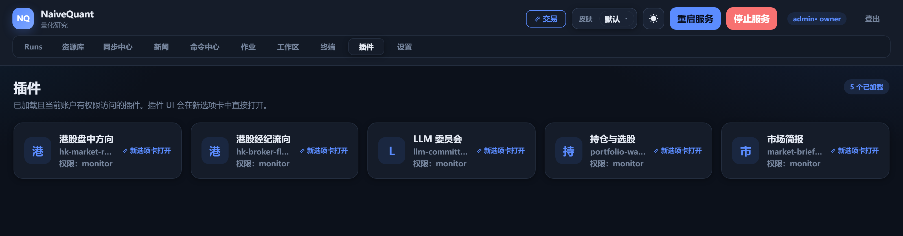
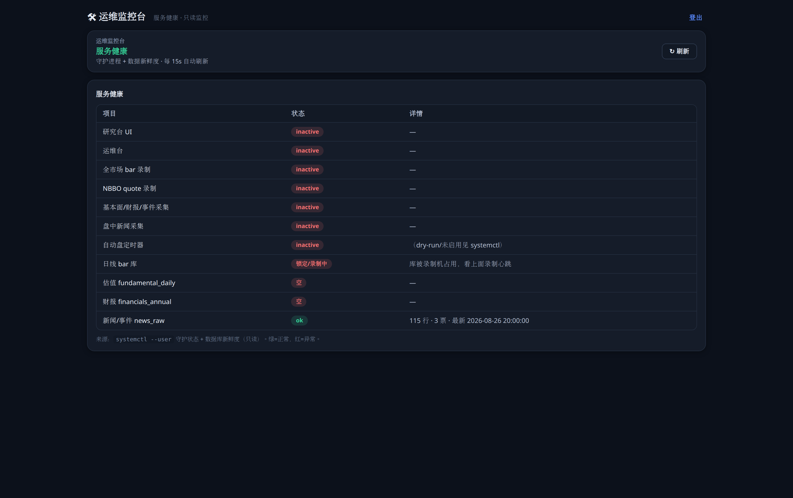

<div align="center">

# NaiveQuant · 量化交易平台 Showcase

**一个人写的量化交易系统，研究、回测、执行、运维都自己做**

`Python` · `DuckDB` · `FastAPI` · `Svelte 5` · `PyTorch` · `LangGraph` · `systemd`


> 这个仓库只用来展示：介绍 NaiveQuant 的架构、能做什么、部分实现思路，以及在平台上做过的一项研究。
> 源码不公开；想看代码的话，可以在面试或技术交流时现场演示。

</div>

---

## 一、项目概况

**NaiveQuant** 是我一个人设计并实现的量化交易平台，从数据采集一直做到实盘运维：

```
数据采集 → 因子挖掘 / 模型研究 → 择时 / 组合构建 → 策略 → 风控 → 执行下单 → 报告 → 运维监控
```

平台的骨架是一条用 YAML 配置的回测 / 实盘流水线：回测入口支持显式 DAG，节点之间靠带版本的产物协议连接，编译阶段就会检查类型、schema、作用域和有没有环；执行层只拿最终生成的账户决策。0.22 之后的重点是因子研究的基础设施：面板计算引擎、可重算的冻结信号、逐年因子挖掘，以及按年份、按步骤自动跑完的调度和资源账本（见第二节）。

| 维度 | 规模 |
|---|---|
| 代码量 | **258,000+ 行** Python（1,220 个模块文件）+ 约 **15,000 行** Svelte / JS 前端 |
| 构成 | 核心平台 143k · 插件 41k · 测试 52k · 脚本工具 13k · 独立服务 8k |
| 核心子系统 | **29** 个顶层包（data / factor / ml / timing / strategy / portfolio / risk / policy / execution / trading 等） |
| 测试 | 229 个测试文件、**2,170+** 个测试函数，按域拆分子集 |
| 依赖红线 | **20** 条 import-linter 分层契约，随 lint 强制执行 |
| 覆盖市场 | 美股、港股、A 股（含 A 股分钟线与 L2 逐笔 / 盘口）；**5 个券商适配器** |
| 插件 | **7** 个白名单治理插件，启停零代码改动 |
| 前端 | Svelte 5 研究控制台（27 个功能页）+ 独立运维监控台 |

### 界面预览（0.36）

> 截图中的账户名、个人信息、策略与因子名称、流程名、运行编号、代码版本号与本地路径已替换为占位文字
> （如“示例策略 A”“因子 01”“研究工作区”“••••••”）。指标数值、图表与页面结构未作改动。

**① 回测记录**：左侧是可按库 / 类型 / 状态 / Sharpe / Alpha 过滤的运行列表；右侧是关键指标与运行详情（配置、命令、代码版本、输出目录），每次运行都可按编号复原。



**② 净值曲线**：策略净值、基准与初始本金对照，可切线性 / 对数纵轴。图中是最新一次回测的策略（见第三节）。



**③ 全部指标**：一份完整的指标表。执行成本分项列出（佣金、印花税、滑点等），并写清成本怎么算：硬费用直接从现金里扣，执行成本通过成交价影响净值，两者不重复计。



**④ 因子库**：候选 / 观察 / 正式 / 退役各状态的因子，附多头信息比率、IC、ICIR 等成绩；升级、退役等生命周期操作只能由人执行，程序挖掘出的因子只能进入候选。



**⑤ 因子挖掘**：逐年挖掘的年度报告，能看到每年候选过了几道入库条件后还剩多少、各个库进了多少，异常年份会给提醒（比如某一年某个库一个也没进）。



**⑥ 任务**：流程调度的运行状态。逐年挖掘按“年份 × 步骤”展开，每一格是一个步骤的用时、内存与显存峰值；失败、被资源守护终止、自动重试等事件在上方提醒。



**⑦ 数据目录**：按“市场 × 资产类别 × 数据类型 × 频率”登记的全部数据集，以及各自的存储格式与状态。



**插件页与运维监控台**（0.21 时的截图，功能延续至今）：





> 运维台截图来自本地演示环境，因此守护服务显示为 `inactive`；生产服务器上各常驻服务均正常在线。
> 该页面提供只读汇总，以及受 RBAC + TOTP 保护的有限控制操作。

---

## 二、主要功能

### 数据层：多来源数据，能按当时可见的信息对齐

- **统一的数据目录（DataCatalog）**：用 `(market, asset_class, datatype)` 三个字段定位数据，业务代码不用直接碰底层文件和表结构；具体存在哪由 `config/data_catalog/` 统一声明，覆盖 A 股、港股、美股的 bars、L2 逐笔与盘口、指数、期指等数据集。
- **SEC EDGAR 财报采集**：直接读 `data.sec.gov` 的 XBRL，同时记录财报所属周期和实际公布时间（`period_end` 和 `filed → available_at`），免得把当时还没公布的数据算进回测，产生前视偏差。
- **行情采集**：录制 Alpaca 全市场分钟 bar、观察列表的 NBBO quote 高频数据，以及港股日线和 A 股 L2 数据，攒自己的历史样本。
- **仿射复权**：0.21 起复权统一写成 `adjusted = raw × A + B`。港股的 A、B 由 Futu 官方 `get_rehab` 事件组合得到（按倒序语义），取代了之前按前收盘价比值推算的做法；这样现金分红和拆并股就落在同一条复权链上，跟官方 HFQ 抽样对账的相对误差约 5ppm。A 股和美股只有单比例的，用 `B=0` 兼容。
- **用 DuckDB 存数据**：DuckDB 同一时刻只允许一个写入者，所以写了套短事务的写入方式——采集进程写完就立刻放开连接，研究端可以同时只读。可更新的库和静态研究库分开管理只读连接，采集时不用把整个研究服务停掉。

### 研究层：因子、模型、时序择时

- **流水线 DAG**：`pipeline.graph.nodes` 支持多节点，同一种 provider 也能配多个；加载时就会检查并拒掉重复 ID、未知 provider、缺输入、类型或 schema 不符、成环、非法 scope、缺 execution sink 这些情况。产物有固定标识，会进通用缓存。
- **面板计算引擎**：因子统一写成面板表达式（一套公式语言加注册的算子），同一个引擎在 GPU 或 CPU 上算，截面的预处理、中性化和打分共用一套实现。
- **机器学习**：传统模型、PyTorch 深度模型，以及 PPO / DQN 这类连续仓位控制实验。
- **时序择时**：顶层 `timing` 领域统管日频、bar 和事件三种时钟，公共 provider 只有一个，市场差异交给数据路由和执行节点。还有一道“不达标就不放行”的验证闸门：加权 OOS R²、Top 桶净收益、命中率、持久性和有效样本量，只要有一项不达标就不出进场决策。
- **可复现训练**：统一随机种子和线程数，尽量压低多进程训练带来的随机差异。
- **运行归档**：每次回测、因子挖掘、可视化研究都会把配置、命令、标的、指标、权重、账户决策、成交和报告存进归档库，之后可以用 `nquant db repro <run_id>` 把当时的运行条件还原出来。
- **因子 / 策略库**：用 DuckDB 维护候选、观察、生产、退役几种状态，按评价口径分库，保留审计日志，入库后继续做样本外跟踪。

### 因子研究基础设施（0.22—0.36 新增）

- **冻结信号**：入库的因子（公式或者训练好的模型）连同定义、权重、原料规格一起保存并算哈希；同时规定从哪天起可用（早停年份之前不给值）。之后随时能在另一块数据面板上重算并核对。
- **结果跟面板起点无关**：每个算子登记自己的“记忆长度”，嵌套时相加，面板开头历史不够的行不给值。同一个因子在同一天，要么给出跟面板起点无关的值，要么就不给——这是“冻结后能重算”的前提，平台有覆盖全部算子的测试盯着。
- **公式搜索分三层**：算子、搜索空间、搜索算法各自注册和配置。搜索空间带量纲规则（原始值的加减只允许同量纲之间），并限制窗口档位和冗余嵌套，减少同一个公式的不同写法。默认的分层搜索先算全部小公式，再在表现好的小公式之间逐层组合；逐日成绩表让同一个公式在一块面板上只算一次，跨年复用。
- **逐年因子挖掘**：每一年只用上一年年末之前的数据，依次做公式搜索、公式入库、模型训练（截面注意力网络和梯度提升树）、模型入库和报告。入库门槛用安慰剂检验来校准——把股票和未来收益的对应关系打乱后重跑整个流程，按联合通过率定阈值；入库只到候选，正式用不用由人来定。
- **流程调度和资源账本**：多步骤、多年份的长任务写成流程定义，界面上能看到每一格的进度、用时和资源峰值，失败了从断点接着跑。吃内存和显存的步骤先向资源账本领额度，超了就由守护进程终止，再按设定次数重试。

### LLM 投研：从改外部框架到自己内置一个委员会

最早是直接改 **ai-hedge-fund / TradingAgents / Vibe-Trading** 这些外部多 Agent 框架，把数据源换成平台自己的数据目录。现在这条链路已经收成内置的 `llm-committee` 插件：19 个分析师 Agent（价值、成长、估值、技术、情绪、新闻、风控、组合经理等），风控和组合决策都在插件内部，不再依赖任何外部代码。

汇总由 `naivequant.committee` 负责：做稳定性校准、分歧衡量、决策区间和黏性控制。每个 Agent 的稳定性表按 `provider::model` 索引；如果当前模型没有足够的专属样本，就退回聚合值，并在报告里标出回退来源。它只输出目标权重和最新价，下单、dry-run、paper/live、对账和熔断都走平台原有的链路。

### 交易层：多市场统一执行

基于同一套执行协议，已对接 5 个券商适配器：

| 适配器 | 市场 | SDK |
|---|---|---|
| Alpaca | 美股 | alpaca-py |
| Futu / 富途 | 港股 · 美股 | futu-api |
| IBKR / 盈透 | 全球 | ib_insync |
| Longbridge / 长桥 | 港股 · 美股 | longport |
| QMT / miniQMT | A 股 | xtquant |

- **事件驱动的实盘**：订单状态、对账、授权审计、保护性熔断、持仓快照都只追加地写进 JSONL 文件，方便多个进程一起记录，也避开了跟数据库抢写锁。
- **L2 逐笔执行**：A 股的逐笔 / 盘口链路按“一档最多吃多少”和整手约束算开仓数量；T+1 退出时会再查一遍盘口容量、可成交的时间窗、成本和实际持仓，数据缺了就拒绝成交。
- **默认不下单**：新账户默认走模拟或 dry-run，没明确配好实盘参数就不会真下单。
- **能不能上实盘要先过检查**：把几个关键开关汇总成一条就绪红线，凭证、账户、风控配置没齐的时候进不了实盘。

### 插件体系：能扩展，也有边界

插件由一份白名单 YAML 管理：开关只改一行 YAML，不用动代码，`git diff` 里看得到，运维台也能看到结果。约定是单向的：插件 import 平台的公开 API，平台从不 import 插件（按名字动态加载）；依赖各自隔离；启用了但没装、或者版本不兼容，就直接报错，不会静悄悄地降级。

| 插件 | 作用 |
|---|---|
| `portfolio-watch` | 多市场同源指标选股、加密持仓研究、衍生品覆盖反查、轮证街货比与只读调仓论证 |
| `llm-committee` | LLM 委员会 Live 信号 provider（19 Agent + 稳定性校准） |
| `hk-broker-flow` | 港股经纪商流向：OpenD 白名单采集 + 研究回放 + 运维管理 |
| `hk-market-regime` | 港股盘中方向：指数、市场宽度、期指为主，经纪流作为新鲜度与覆盖率门控的确认因子 |
| `market-briefing` | 跨市场（韩股 / A 股 / 港股）行情简报，纯数据 + 可选轻量 LLM 总结，无交易决策权限 |
| `notifications` | 可靠通知投递常驻服务；监控与交易模块只负责产出事件 |
| `system-monitor` | 主机、服务、采集器、磁盘、网络和 IO 的统一只读资源遥测 |

### 运维层：部署、鉴权和监控

- **systemd --user 守护**：开启 linger 后免登录常驻，服务崩了自动重启；16 个 unit 覆盖研究台、运维服务、各插件的常驻进程和定时采集任务。
- **多用户鉴权**：`naivequant/auth/` 是研究台和运维台共用的一套安全底子，分三层管：你是谁（token 或签名会话）、你能做什么（RBAC 三层加权限集合，敏感操作要 TOTP 和双人审批）、作用范围（部署级还是个人设置，密钥按用户分目录，交易凭证单独命名空间）。落盘文件一律 `0600` 原子写，并留访问审计。
- **内网访问**：服务只绑 `127.0.0.1`，通过 SSH 隧道访问，不直接暴露到公网。
- **独立的运维监控台**：FastAPI + Svelte，和研究控制台分开部署，避免服务操作绕过登录和 RBAC。
- **凭证处理**：主口令只注入 systemd 用户管理器的内存；密钥加密落盘，用到的时候再解密到内存。
- **通用的加密同步层**：一层跟业务无关的信封加解密原语，因子、策略、风控等模块各自把数据打包后复用同一套密钥管理。
- **部署脚本**：`sync → install → services`，用增量 rsync；只能部署到名单内的服务器（名单外的机器连都连不上），装完自动跑一遍冒烟自检和版本核对。

---

## 三、最新回测的策略

最近一次回测（2026-10-10）是一个 A 股纯多头选股策略，用来看看逐年因子库放到组合里效果怎么样：

- **信号**：每年用当年的逐年因子库（只用上一年年末之前的数据挖出来的），由一个组合模型给各个因子打分再加权；模型的训练标签跟实际持有期对齐（10 日）。
- **交易**：第 $t$ 日收盘后打分，第 $t+1$ 日收盘成交；持仓带排名缓冲（排名掉出一定范围才卖）；按 A 股的真实规则撮合（T+1、涨跌停、印花税和佣金）。
- **范围**：2010—2025 年，5,418 只股票，11,301 笔成交，初始资金 100 万；基准是中证 500。

| 指标 | 数值 |
|---|---|
| 年化收益 | 22.73% |
| 年化 Alpha | 17.84% |
| 夏普比率 | 0.87 |
| 最大回撤 | 44.97% |
| Beta | 1.045 |
| 平台综合评级 | **淘汰**：踩到风险底线“最大回撤超过 25%” |

分段看（按每年 243 个交易日年化，基准为中证 500）：

| 时段 | 策略年化 | 基准年化 | 差 | 最大回撤 | 夏普 |
|---|---:|---:|---:|---:|---:|
| 2010—2016 | 29.9% | 4.7% | +25.2% | 37.5% | 1.00 |
| 2017—2025 | 16.0% | 2.0% | +14.0% | 45.0% | 0.72 |
| 2023—2025 | 18.8% | 8.4% | +10.4% | 32.0% | 0.86 |

<details>
<summary>逐年收益</summary>

| 年份 | 策略收益 | 中证 500 | 超额 | 当年最大回撤 |
|---|---:|---:|---:|---:|
| 2010 | +12.4% | +8.3% | +4.1% | -28.2% |
| 2011 | -15.8% | -33.8% | +18.1% | -28.0% |
| 2012 | +14.6% | +0.3% | +14.3% | -27.1% |
| 2013 | +54.0% | +16.9% | +37.1% | -13.1% |
| 2014 | +56.5% | +39.0% | +17.5% | -10.3% |
| 2015 | +163.0% | +43.1% | +119.9% | -37.5% |
| 2016 | -9.5% | -17.8% | +8.3% | -26.8% |
| 2017 | +18.2% | -0.2% | +18.4% | -14.2% |
| 2018 | -20.3% | -33.3% | +13.1% | -31.9% |
| 2019 | +51.3% | +26.4% | +24.9% | -23.0% |
| 2020 | +40.6% | +20.9% | +19.8% | -16.2% |
| 2021 | +34.2% | +15.6% | +18.6% | -25.9% |
| 2022 | -15.7% | -20.3% | +4.6% | -25.8% |
| 2023 | +4.8% | -7.4% | +12.2% | -12.7% |
| 2024 | +6.6% | +5.5% | +1.2% | -24.6% |
| 2025 | +49.7% | +30.4% | +19.3% | -15.6% |

</details>

**结论：这个策略没过验收。** 一是平台的风险底线（最大回撤不超过 25%）直接把它判成淘汰；二是研究自己的标准要求相对中证 500 年均超额 20% 以上、最近 5 年每年不低于 10%，而它 2024 年超额只有 1.2%；三是按同样的组合规则，它近几年也没比“所有因子等权”这个简单对照好多少。把它放上来，是想说明平台怎么记录、评价、最后否掉一个策略，而不是说这是个能用的策略。

---

## 四、研究：A 股逐年因子库构建

📄 论文：[A 股逐年因子库构建研究——研究过程、主要问题与处理办法](papers/A股逐年因子库构建研究.pdf)（25 页）

在平台上完成的一项研究：2010—2025 年的每一年，都只用上一年年末之前的数据，从约 2.4 万个候选公式和 205 个模型输出里挑因子，逐年搭一个只看多头端的 A 股因子库。论文按“问题—检验—原因—处理”一条条记录研究里踩到的坑，也附了方法细节和算例。几个主要发现：

- **用一年做验收，反映的主要是那一年的行情**：验收这一年过不过门槛，对下一年的表现看不出什么预测作用。
- **入库门槛要按整套条件的联合通过率来定**：两段各取高分位再要求同时满足，会严到几乎挖不出东西；校准值在窗口之间忽高忽低，那是估计误差，不是趋势。
- **数值实现上的缺陷会直接改变结论**：并列值的截面排名曾经按股票代码排序，结果神经网络实际上把代码顺序当成了输入；单精度累加会让统计量随数据起点变化。
- **神经网络对随机种子很敏感**：同一个编号的输出跨种子相关性只有 0.2—0.3，所以入库单位改成种子平均后的模型；置换检验显示五种网络结构之间的差异只占 1% 的方差。
- **评价、去重、入库要用同一个标准**：“跟已有因子两两相关低”这种标准会放过换个写法的旧因子，统一改成“能不能提供已有因子之外的信息”。

**怎么做**：研究者提想法、定口径和约束；AI 编程代理（Claude Code）在平台里写代码、写测试、跑实验并记日志；研究者对照结果判断问题出在哪，决定接受、修改还是放弃。核对手段有换一块面板重算并逐位比对、安慰剂对照、置换检验和分时段查看。

---

## 五、系统架构

依赖关系从下往上分层，细节见 [ARCHITECTURE.md](ARCHITECTURE.md)：

```
L5 交互层     UI(研究台/运维台) · CLI · 报告 · 可视化 · scheduler
L4 编排层     ML流水线 · 回测DAG · 工作流 · 选股 · 优化 · 运行归档
L3 领域层     因子族  ‖  策略/组合/风控/policy 族  ‖  交易族(execution·account·trading)
              └──────────── timing 时序择时领域 ────────────┘
L2 数据/模型  数据引擎 · 财报/基本面 · 数据providers · 模型(RL/深度/确定性) · stats · auth
L1 core 基础  schemas · protocols · artifacts · registry · pipeline_graph ·
              secrets · settings · workspace · data_catalog · secure_bundle
L0 零依赖层   constants · logger · config
─────────────
独立服务包    trading_server  ──单向──►  naivequant.*
插件          plugins/*       ──单向──►  naivequant 公开 API（平台永不反向 import）
```

`trading_server` 是单独的服务包，只用 `naivequant` 暴露出来的稳定接口；`naivequant` 不会反过来 import 它。这样服务端的改动和平台内部的重构互不影响。

---

## 六、工程实践

为了让代码能长期维护，定了一些约束，也写了些工具：

- **依赖红线能自动查**：20 条 import-linter 分层契约写进 `pyproject.toml`，由 `lint-imports` 强制执行——`core` 不能往上依赖、`auth` 只依赖 `core`、计算层不能依赖界面和入口层等。少数兼容用的 shim 显式列进白名单并写明原因，实现代码不走这些边。
- **重复代码的整理**：纯语言层面的工具放 `core/`，跟 DuckDB 有关的放 `data/`，跟 broker 有关的留在 `trading/brokers/`。语义已经不一样的代码不硬合，先把差异参数化。
- **兼容边界写清楚**：大的入口保留稳定的对外接口，具体职责拆成能单独测试的模块；旧路径通过 re-export 或延迟属性指向同一个实现，但兼容层里不加业务分支；确认没用的旧实现直接删掉，不留转发。
- **版本和变更记录**：提交时同步维护版本常量和 `docs/update-log.md`，按 Added / Changed / Fixed / Tests / Notes 记；0.14.x 及更早已按次版本系列归档。
- **文档一致性检查**：`scripts/check_docs.py` 会全量核对本地链接和 Markdown 锚点、平台与插件版本是否一致、文档索引有没有漏、设计和归档状态标识、环境变量，以及一些关键数量。
- **测试**：229 个测试文件、2,170+ 个测试函数，pytest 按 data / factor / models / brokers / backtest / timing / plugins / trading_server 等域拆成子集。
- **设计文档**：事件驱动实盘、多用户鉴权、通知、磁盘与资源监控、数据目录、加密同步、独立推理模块依赖固化等子系统，都有各自的设计文档。

---

## 七、技术栈

| 层面 | 技术 |
|---|---|
| 语言 | Python 3.12 / 3.13 |
| 数据 | DuckDB · pandas · pyarrow · SQLite（遥测） |
| 存储寻址 | 自研 DataCatalog（市场 / 资产类别 / 数据类型） |
| 流水线 | 自研的版本化产物协议 + DAG 编译器 / runner / 产物缓存 |
| Web / API | FastAPI · uvicorn |
| 前端 | Svelte 5（`$state`/`$derived` runes）· Vite |
| 机器学习 | scikit-learn · PyTorch · LightGBM · 自研 RL（PPO/DQN） |
| LLM 投研 | LangChain · LangGraph · DeepSeek / Claude / OpenAI Responses |
| 券商 | alpaca-py · futu-api · ib_insync · longport · xtquant |
| 质量保障 | pytest · ruff · import-linter · 自研文档一致性检查 |
| 部署 | Linux · systemd (--user) · SSH 隧道 · rsync 部署链 |

---

## 八、源码说明

这个仓库只做展示用，源码目前不公开。这里讲的都是系统结构、能做什么，以及一些关键实现思路。

想看完整代码、某个子系统的实现细节，或者聊具体的设计取舍，可以在面试或技术交流时现场演示。

<div align="center">

**作者：Zed XZK**

xizhikun@outlook.com · zedxzk@163.com

</div>
